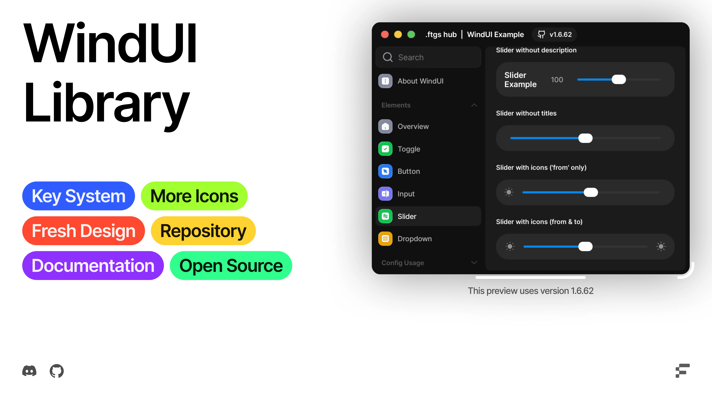

<!--<h1 align="center">WindUI</h1> -->

<!--
<picture>
    <source srcset="docs/banner-dark.webp" media="(prefers-color-scheme: dark)">
    <source srcset="docs/banner-light.webp" media="(prefers-color-scheme: light)">
    
</picture>-->


I might rewrite this project from scratch later.

> [!WARNING]
> This WindUI was not inspired by, and the name has nothing to do with UI Frameworks

> [!WARNING]
> WindUI is currently in Beta.
> This project is still under active development. Bugs, issues, and unstable features may occur. We’re constantly working on improvements, so please be patient and report any problems you encounter.

## Credits

#### Icons (https://github.com/Footagesus/Icons)

- [Lucide-Icons](https://github.com/lucide-icons/lucide)
- [Craft Icons](https://www.figma.com/community/file/1415718327120418204)
- [Geist Icons](https://vercel.com/geist/icons)
- [Solar Icons](https://icones.js.org/collection/solar)
- [SF Symbols](https://sf-symbols-one.vercel.app/)

### Links

- [Discord Server](https://discord.gg/ftgs-development-hub-1300692552005189632)
- [Documentation](https://footagesus.github.io/treehub-web/docs/windui)
- [Installation](https://footagesus.github.io/WindUI-Docs/docs/installation)
- [Example](/main_example.lua) (wip)
    ```luau
    loadstring(game:HttpGet('https://raw.githubusercontent.com/Footagesus/WindUI/refs/heads/main/main_example.lua'))()
    ```

## Ender Hub Info controls

`WindUI:InfoCard`, `WindUI:InfoCredits`, and `WindUI:InfoFeedback` use the fork's
native rounded surfaces, theme colors, font and element radius. See
[Info component documentation](build/pages/info-card.md) for the API and cleanup
contract. These components only display supplied data and invoke supplied UI
callbacks; they do not start network requests or telemetry.

`npm run build` builds the release from the pinned deployed runtime plus the Info
component sources. `npm run build:upstream` retains the original upstream build.
Run `lua tests/InfoCard.lua` to check resizing, actions and cleanup. CI checks the
committed release for reproducibility and does not create bot commits.

## Liquid glass and motion

Visible element surfaces share a restrained squircle glass highlight. Existing
control layouts, colors and explicit animation curves remain supported. Default
transitions use Quint/Out easing; conflicting animations cancel when a replacement
plays, while independent property channels remain active. Idle effects use no
per-control heartbeat or cursor-tracking loop.

```lua
WindUI:SetEffects({Glass = true, Animations = true, ReducedMotion = false})
WindUI:SetEffects({Glass = false, ReducedMotion = true}) -- lightweight mode
print(WindUI.Creator.GetActiveAnimations())
```

Reduced motion removes transition delays and repetitions as well as duration.
Disabling glass hides the static highlight layers. Run `lua tests/Motion.lua`,
`lua tests/Glass.lua`, and `lua tests/InfoCard.lua` for lifecycle and control checks.
These are bounded behavior checks, not a guarantee of a particular frame rate on
all devices. Existing game, executor and application workloads still affect FPS.

Rollback baseline: commit `37cba3a` on `backup/pre-liquid-glass-20261119`. Ask to undo
and the feature commits can be reverted while preserving unrelated later work.
